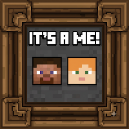
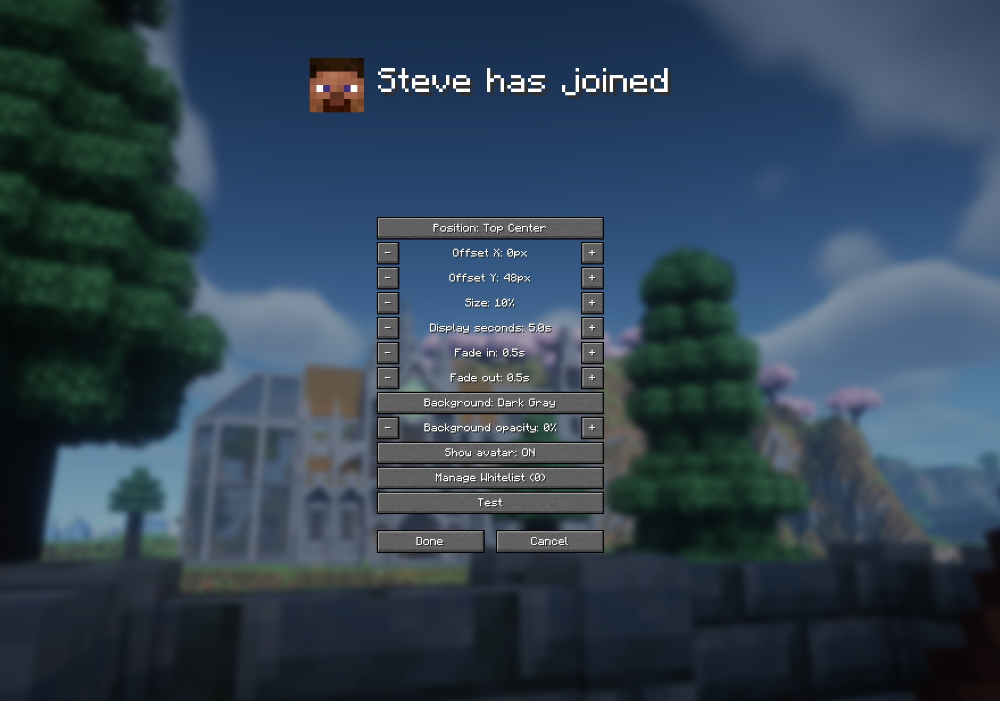

# It's a Me

  

A [Fabric](https://fabricmc.net/) mod for Minecraft that shows an animated banner with a player's
avatar whenever someone joins or leaves the multiplayer server you're on.

> **Note:** this release targets Minecraft **26.2** specifically (see [Requirements](#requirements) below) - it will not load on other versions.



## Screenshots



## Features

- Detects vanilla "X joined/left the game" messages and shows a banner with the player's avatar and name.
- Banner position: pick from 9 anchor points (corners, edges, center) with a pixel offset, cycled clockwise.
- Size: 5%–20% of your screen height (default 10%), so it scales correctly regardless of resolution or GUI Scale.
- Configurable fade-in / hold / fade-out durations (defaults: 0.5s / 5s / 0.5s).
- Configurable background color and opacity (or fully transparent).
- Multiple banners stack and animate out of the way as new ones arrive; each keeps its own independent fade timing.
- Per-server whitelist: restrict banners to specific players, with a searchable live list of who's currently online to add from, plus manual add/remove.
- In-game settings screen with a live preview - reachable via:
  - `/itsame` chat command
  - An optional keybind (unbound by default - set one in Options → Controls → Key Binds → search "It's a Me")
  - [ModMenu](https://modrinth.com/mod/modmenu), if installed (Mods → It's a Me → gear icon)
- A **Test** button in settings to preview the banner with your own name/skin without waiting for a real join/leave.

## Requirements

- Minecraft **26.2**
- [Fabric Loader](https://fabricmc.net/use/) **0.19.3+**
- [Fabric API](https://modrinth.com/mod/fabric-api) **0.155.2+26.2**
- Java 25+

## Installation

1. Install [Fabric Loader](https://fabricmc.net/use/) for Minecraft 26.2.
2. Download the latest jar from the [Releases](../../releases) page.
3. Download [Fabric API](https://modrinth.com/mod/fabric-api) for 26.2.
4. Drop both jars in your `mods` folder.

## Configuration

Settings are stored at `config/itsame.json` and are also editable in-game (see above). All changes
made in the settings screen apply live and are only written to disk when you press **Done**
(**Cancel** discards them).

## Building from source

```
./gradlew build
```

The built jar will be at `build/libs/itsame-<version>.jar`. `./gradlew runClient` launches a
development client for testing.

## License

[CC0-1.0](LICENSE)
